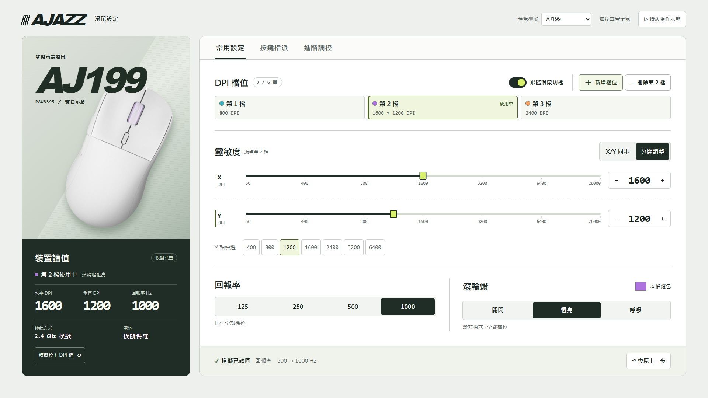
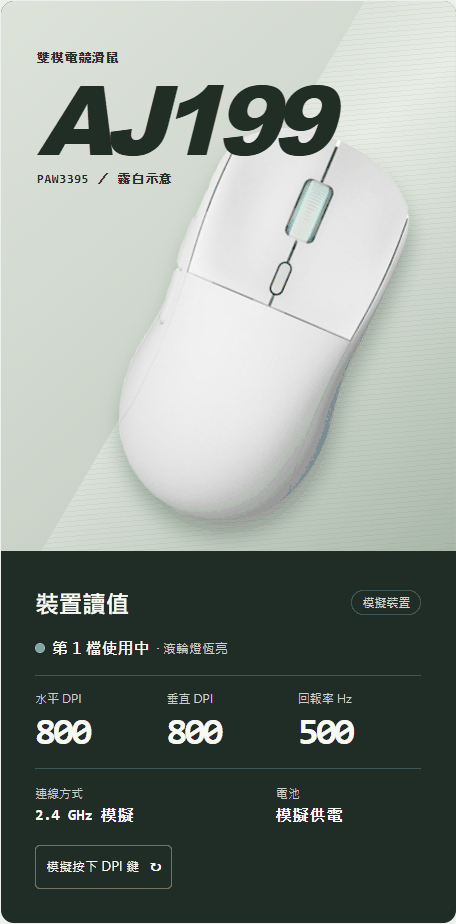
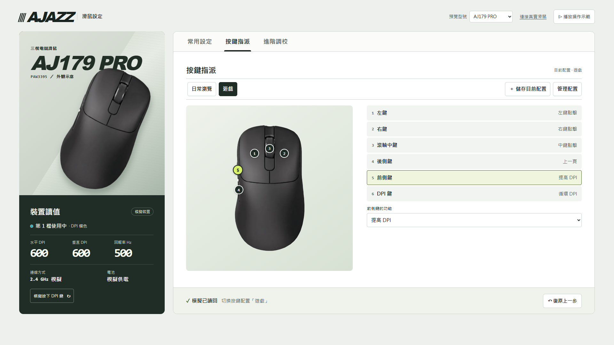
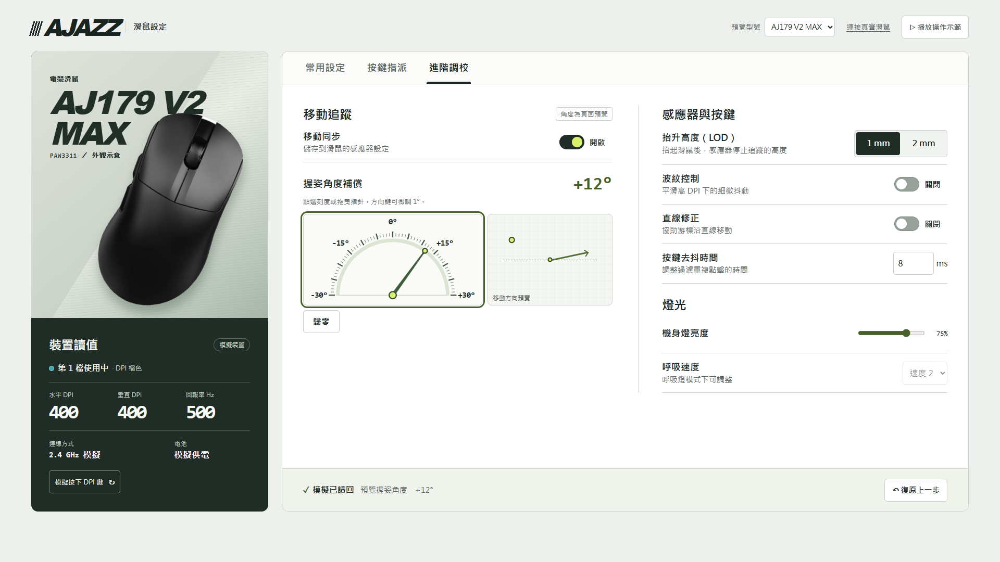

# AJAZZ Web Driver

透過桌面瀏覽器調整 AJAZZ 滑鼠的 DPI、回報率、燈效與按鍵指派。這是社群開發的繁體中文 WebHID 工具。變更會直接寫入滑鼠，再從裝置讀回確認。模擬模式可以在沒有滑鼠時試用介面。

## 畫面與功能展示

以下三張畫面取自網頁的模擬模式，解析度為 1920 × 1080。左側顯示目前使用中的檔位與讀值，右側是設定區。圖中的數值與配置名稱皆為操作範例。

### AJ199 · 分別調整水平與垂直 DPI



選取檔位後，按「分開調整」即可分別設定 X、Y 軸。圖中保留 X 軸的 1600 DPI，選取 Y 軸並點「1200」快選，只降低垂直靈敏度。回報率則由所有檔位共用。開啟「跟隨滑鼠切檔」後，按滑鼠的實體 DPI 鍵，編輯區也會切到目前檔位。

<details>
<summary>觀看 AJ199 切檔與關燈動畫</summary>

在模擬模式按「模擬按下 DPI 鍵」，左側讀值從 800 變成 1600 DPI，照片上的滾輪也從青色變成紫色。將「滾輪燈」設為「關閉」後，再切回 800 DPI，滾輪會保持熄滅。



</details>

### AJ179 PRO · 一鍵切換六鍵配置



在「按鍵指派」點選照片上的編號或右側按鍵名稱，再選擇功能。例如，先把原本的六鍵配置存成「日常瀏覽」，再將前側鍵從「下一頁」改成「提高 DPI」，另存為「遊戲」。之後點上方的配置名稱，就能切換整組六鍵指派。

### AJ179 V2 MAX · 進階調校與握姿預覽



右側可選擇抬升高度（LOD）、調整按鍵去抖時間與機身燈亮度。這款型號的「移動同步」對應滑鼠感應器設定，目前待實機驗證。想預覽握姿角度，可拖曳半圓指針到圖中的 +12°，再把游標移入右邊方格觀察方向變化。方向鍵每次微調 1°，「歸零」可回到 0°。角度調整只作用於頁面預覽。

## 支援型號

| 型號 | 已實作的連線 | 功能與驗證狀態 |
| --- | --- | --- |
| AJ199 一般版 | USB、2.4 GHz | 已用實機驗證。支援 DPI 檔位增刪、X/Y 分軸、回報率、滾輪燈及按鍵配置。 |
| AJ179 PRO | USB、2.4 GHz、藍牙 | 依公開協定實作，尚待本專案實機驗證。支援 X/Y 分軸與各檔指示色，USB 最高 1000 Hz，2.4 GHz 接收器提供最高 8000 Hz 的設定。 |
| AJ179 V2 MAX | USB、2.4 GHz | 依公開協定實作，尚待本專案實機驗證。提供六個 DPI 儲存位置、X/Y 同步、機身燈效及移動同步。修改 DPI 檔色請使用 USB。 |

頁面會依裝置回報的型號選擇通訊協定與產品照。在頁首的「機身顏色」選擇白色或黑色，首頁照片與按鍵位置圖會一起換色。這項外觀偏好由瀏覽器依型號記住，模擬與實機模式共用。滾輪燈色仍由 DPI 檔位與燈效設定控制。六鍵配置也儲存在目前瀏覽器，各型號分開管理。

滑鼠圖左下角列出感應器、最高靈敏度與目前連線的回報率上限。點「詳細規格」可查看重量、尺寸、電池容量及各連線的上限，窄螢幕可從頁首開啟。AJ179 PRO 使用 USB 時可選到 1,000 Hz，2.4 GHz 可選到 8,000 Hz，藍牙固定 125 Hz。模擬模式預設為 2.4 GHz，可在「裝置讀值 → 連線方式」切換比較。規格來源見 [AJ199 產品頁](https://epomaker.es/products/ajazz-aj199)、[AJ179 PRO 使用說明書](https://drv.dns-shop.ru/drivers/oth/M/mys-besprovodnaaprovodnaa-ajazz-aj179-pro_instrukcia_212912_12032026.pdf) 與 [AJ179 V2 MAX 使用說明書](https://manuals.plus/ajazz/aj179v2-max-max-tri-mode-game-mouse-manual)。

## 在本機使用

需要 Python 3 和支援 WebHID 的桌面版 Chrome 或 Edge。下載專案後，在含有 `index.html` 的目錄啟動靜態伺服器。

```sh
python -m http.server 8000 --bind 127.0.0.1
```

- **連接實機**　開啟 [本機設定頁](http://127.0.0.1:8000/)，按「連接滑鼠」並在瀏覽器選擇裝置。修改後可在頁面下方查看寫入與讀回結果。
- **試用介面**　開啟 [模擬模式](http://127.0.0.1:8000/?mode=demo)，從「預覽型號」選擇滑鼠。此模式使用範例資料。

專案使用原生 HTML、CSS 與 JavaScript，可直接由靜態伺服器提供。自行架站時請使用 HTTPS，讓瀏覽器開放 WebHID。

## 協定與圖片來源

- AJ199 的通訊與燈效參考 [OpenAjazz](https://github.com/taylors42/OpenAjazz/blob/main/docs/POC.md) 和 [ajazz-linux 的實機紀錄](https://github.com/a32fred/ajazz-linux/blob/main/docs/reference/HARDWARE_FINDINGS.md)。
- AJ179 PRO 參考 [OpenMouse 的 AJ179 PRO 協定](https://github.com/OpenMouse-Project/mouse-protocol/blob/main/docs/ajazz-aj179-pro.md)。
- AJ179 V2 MAX 參考 [Ajazzy 的封包與讀回紀錄](https://github.com/Geovane2dd/Ajazzy/blob/main/docs/reverse-engineering.md)。

產品照片由外部圖源提供。若要離線顯示，可建立 `assets/` 目錄，把以下圖片存成表內的檔名。頁面會優先使用本機檔案。

| 型號 | 本機檔名 | 來源 |
| --- | --- | --- |
| AJ199 白色 | `aj199-white.jpg` | [產品照片](https://cdn.shopify.com/s/files/1/0726/8528/9780/files/9_a2300fdc-7486-48b1-a5f4-0f788a1109ca.jpg?v=1714017706&width=940) |
| AJ199 黑色 | `aj199-black.jpg` | [產品照片](https://cdn.shopify.com/s/files/1/0726/8528/9780/files/10_5564463f-c005-4ecc-9ee0-027250d60b34.jpg?v=1714017706&width=1000) |
| AJ179 PRO 黑色 | `aj179-pro.png` | [GearDB 產品照片](https://geardb.cn/api/v1/images/85c443a1-26b9-45e1-b274-58c2ad840c78.png) |
| AJ179 PRO 白色 | `aj179-pro-white.png` | [AJAZZ 產品照片](https://ajazz.com.ua/sites/default/files/styles/product_image_l/public/products/3_82.png?itok=gRO6qqfw) |
| AJ179 V2 MAX 黑色 | `aj179-v2-max.png` | [GearDB 產品照片](https://geardb.cn/api/v1/images/9b3ab62a-8a6f-466e-a0c3-9a0a9fc5970f.png) |
| AJ179 V2 MAX 白色 | `aj179-v2-max-white.png` | [AJAZZ 產品照片](https://ajazz.com.ua/sites/default/files/styles/product_image_l/public/products/AJ179-V2-MAX-W%201.png?itok=_irn9vlp) |

## 授權

程式碼與本專案文件採用 [MIT License](LICENSE)。產品照片與商標的權利屬於各自權利人。
